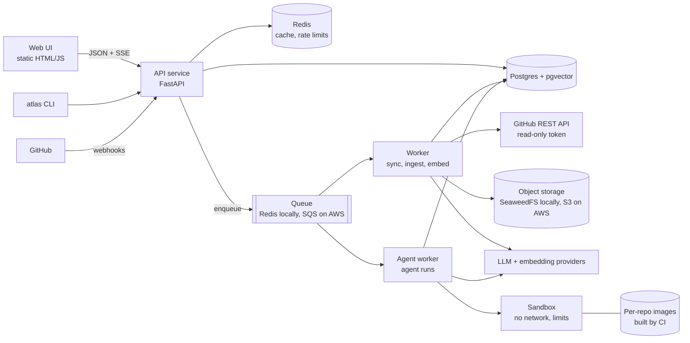
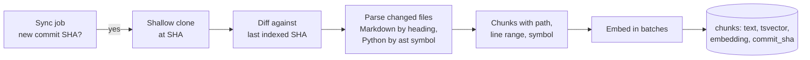
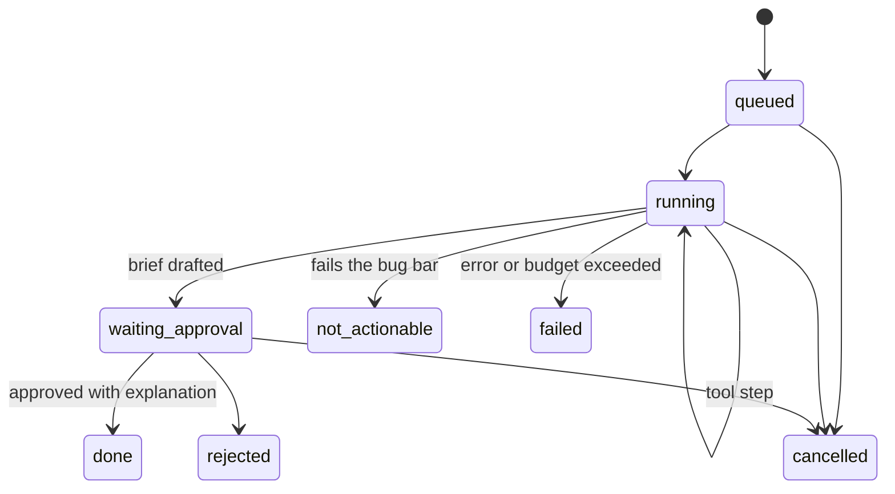
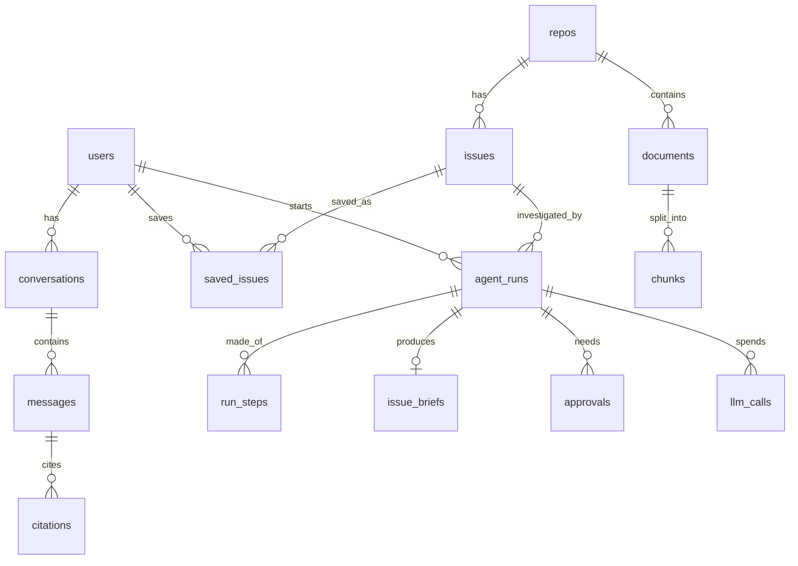
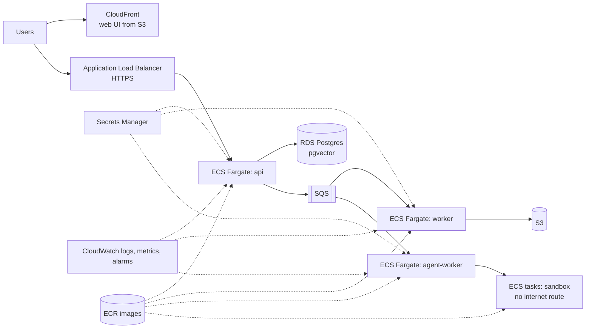

# 03. Architecture

This is the end state after Part 8. Earlier parts build subsets of it; [04-curriculum.md](04-curriculum.md) says which.

## Components



| Component | Responsibility | Why separate |
|---|---|---|
| API service | HTTP, auth, validation, search, Q&A streaming, run control. Async (FastAPI + async SQLAlchemy) from lesson 4.17 | Must answer in well under a second |
| Worker | GitHub sync, cloning, parsing, chunking, embedding | Jobs take seconds to minutes and must retry safely |
| Agent worker | Executes agent runs step by step | Runs take minutes, pause for approval, and need sandbox access the API must never have |
| Sandbox | Runs untrusted generated code | Isolation: no network, no secrets, hard resource limits |
| Postgres | All durable state, full-text search, vectors (pgvector) | One database keeps the course simpler than adding a vector DB |
| Scheduler and notifier | `atlas scheduler` queues syncs; `atlas notifier` turns `issue.updated` stream events into notifications | Small loops with one job each; safe to duplicate |
| Redis | Local queue, search cache, rate limits, the `issue.updated` event stream | Fast shared state between processes |
| Object storage | Repository snapshots (`snapshots/<repo>/<commit>.tar.gz`), downloaded through presigned links | Large immutable files don't belong in Postgres or pass through the API |

The queue carries only a job id; the job's kind, repository, status, attempts and last error live in the Postgres `jobs` table. This makes jobs idempotent and inspectable (lessons 5.1 to 5.3, decision D26). Events are different from jobs: the issues sync publishes `issue.updated` to a Redis Stream, and each feature that cares reads it with its own consumer group (lesson 5.6, decision D27).

## LLM and embedding providers

One small interface, several implementations, chosen by configuration.

```python
class ChatProvider(Protocol):
    def complete(self, request: ChatRequest) -> ChatResult: ...
    def stream(self, request: ChatRequest) -> Iterator[ChatEvent]: ...

class EmbeddingProvider(Protocol):
    model: str
    dimensions: int
    def embed(self, texts: list[str], purpose: Literal["document", "query"]) -> list[list[float]]: ...
```

| Implementation | Used for | Notes |
|---|---|---|
| `ClaudeChat` | Hosted chat, tool use, structured output | Optional (`LLM_PROVIDER=anthropic`, decision D28). Official `anthropic` Python SDK only. Default model `claude-opus-5-5`, configurable. Streaming for long outputs, adaptive thinking, `tool_choice: auto` with `strict: true` tools (forced tool choice is not supported on current models), refusal stop reason handled. |
| `OllamaChat` | Default chat (decision D28) | Ollama's HTTP API via `httpx`. Default model `qwen3:1.7b`, configurable. |
| `OllamaEmbeddings` | Default embeddings | Local, free. `nomic-embed-text` (768 dimensions), configurable. |

Every call is logged to `llm_calls` (provider, model, purpose, input and output tokens, cost, latency, run id). Cost and rate limits are enforced from that table.

`ChatRequest`, `ChatResult` and `ChatEvent` are deliberately thin neutral types at the boundary. Inside each implementation we use that provider's own SDK types.

Changing the embedding model changes the vector dimensions and invalidates stored vectors, so each chunk records the embedding model name, and switching models triggers a full re-embed.

## Ingestion pipeline



- Python is chunked by structure (module header, function, method as `Class.method`, class header) using `ast`, so a chunk is a complete unit with exact line numbers. Python that doesn't parse, and other text, falls back to 40-line windows; no chunk exceeds 60 lines.
- Markdown and reStructuredText are chunked by heading; a chunk's symbol is its heading path (`Install > From pip`).
- Re-indexing touches only changed files; deleted files remove their chunks. A new chunk identical to an old chunk of the same file keeps its vector.
- Embedding is its own job, `embed_repo`: batches of 16, one transaction each, about three minutes per run, then the job re-queues itself ("continued") until nothing is pending (D29).

## Retrieval and answering

1. Keyword search (Postgres full-text) and vector search (pgvector HNSW index, `hnsw.ef_search` raised to the candidate count) each return 50 candidates, filtered by repository, kind and, for vectors, embedding model.
2. Results merge with reciprocal rank fusion (k = 60). `GET /search?mode=` also offers each search alone; if the embedding model is down, search falls back to keywords and says so in `X-Search-Mode`.
3. `POST /ask` (lesson 6.7) first checks the nearest chunk's cosine similarity: below 0.6 (measured for `nomic-embed-text`), Atlas answers "I couldn't find this in the indexed code." without calling a model. Otherwise the five best fused chunks go into the prompt, numbered, after up to three earlier turns of the conversation (without their sources); the citation rule is repeated after the sources, where a small model still follows it. A follow-up is searched together with the previous question.
4. The model cites sources as `[n]`; Atlas checks each number against the sources, reports made-up ones, and stores citations as copies (path, lines, symbol, commit) so they survive re-indexing. Links point at the indexed commit on GitHub.
5. The answer streams to the client over Server-Sent Events (FastAPI's `EventSourceResponse`): `sources`, then `delta` events, then `done` or `error`. Checks that should be a 404 run in a dependency, before the stream starts. Nothing is stored unless the answer completes.

## Agent runs

A run is a state machine stored in Postgres. The agent worker advances it one step at a time, so a crash or deploy resumes from the last completed step.



The agent loop is our own code on the Messages API, not a hosted agent service, so it works with any provider (including local models) and so learners build and understand it.

**Tools** (allowlisted per run, schemas strict):

| Tool | Does | Side effects |
|---|---|---|
| `search_codebase` | Hybrid search over the indexed target | None |
| `read_file` | Read a file range at the indexed commit | None |
| `run_in_sandbox` | Run a script or command in the target's sandbox image | Sandboxed only |
| `record_finding` | Save a structured finding to the run | Writes to the run only |
| `submit_brief` | Finish with the brief's sections as structured data | Moves run to `waiting_approval` |

There is no tool that writes to GitHub, the network, or the host.

## Sandbox

- One image per target repo and commit (`sandbox-images/ignite/Dockerfile`), built by CI on a schedule: Python 3.11 (Ignite's documented dev version), CPU-only PyTorch, Ignite installed editable, and only the dev dependencies needed for core areas (`engine`, `metrics`, `handlers`). The heavy experiment-tracker dependencies in Ignite's `requirements-dev.txt` are left out until a run needs them.
- Run flags locally: `--network none`, memory and CPU limits, `--pids-limit`, read-only root filesystem with a writable tmpfs, non-root user, wall-clock timeout enforced by the worker.
- On AWS: one ECS Fargate task per execution in subnets with no internet route; image pulls and logs go through VPC endpoints.

## Data model



| Table | Key columns |
|---|---|
| `users` | email, password_hash, is_admin, skills_profile |
| `repos` | owner, name, default_branch, last_indexed_sha, last_synced_at |
| `documents` | repo_id, path, kind (doc/code), commit_sha, content_hash |
| `chunks` | document_id, start_line, end_line, symbol, text, tsv, embedding, embedding_model |
| `issues` | repo_id, number, title, body, labels, state, fit_score, fit_reason, etag |
| `saved_issues` | user_id, issue_id (composite key) |
| `conversations`, `messages`, `citations`, `feedback` | chat history and ratings |
| `jobs` | kind, payload, status, attempts, last_error (background job state) |
| `agent_runs` | user_id, issue_id, status, iterations, token_budget, cost |
| `run_steps` | run_id, ordinal, kind, tool_name, input, output, started_at, finished_at |
| `approvals` | run_id, decision, explanation, decided_at |
| `issue_briefs` | run_id, sections (JSON), markdown, repro_verified |
| `llm_calls` | provider, model, purpose, tokens in/out, cost, latency_ms, run_id |

Evaluation data is not in the database: cases, thresholds and hand grades are files in `evals/` (reviewed in pull requests like code), and each run writes a JSON report that CI keeps as an artifact (D30).

## Local development stack

`docker compose up` starts: `api`, `worker`, `agent-worker`, `postgres` (with pgvector), `redis`, `seaweedfs` (S3-compatible object storage, `weed mini`), and optionally `ollama`. Since lesson 7.1 the Atlas processes run from one image (`atlas/Dockerfile`) as compose services under the `app` profile (`docker compose --profile app up -d --build`): `migrate` runs the migrations and exits, then `api`, `worker`, `scheduler` and `notifier` start. Plain `docker compose up -d` still starts only the backing services, for tests and the command line. Tests run against a real Postgres, not SQLite, because pgvector and full-text search are Postgres features.

## AWS deployment



- Everything is Terraform in `infra/`. Nothing is clicked by hand except account creation and the budget alarm.
- Cost guardrails: an AWS Budgets alarm from day one, no NAT gateway (VPC endpoints instead), smallest instance sizes, and a documented `terraform destroy` for when the learner is not using it. Check current prices with the AWS pricing calculator before each deploy.
- Secrets (LLM API key, GitHub token, JWT secret) live in Secrets Manager, never in images or Terraform state outputs.

## Security summary

- GitHub token: fine-grained, read-only, public repositories only.
- Issue and repository text is untrusted. It is delimited in prompts, and the agent's tools have no outward side effects, so injected instructions cannot cause harm beyond a bad brief.
- Short-lived JWT access tokens plus rotating refresh tokens; Argon2 password hashing; optional GitHub sign-in with identity scopes only; `admin` role for repository management.
- Per-user rate limits and LLM spend limits.
- Every agent step and approval is in an append-only audit trail.
